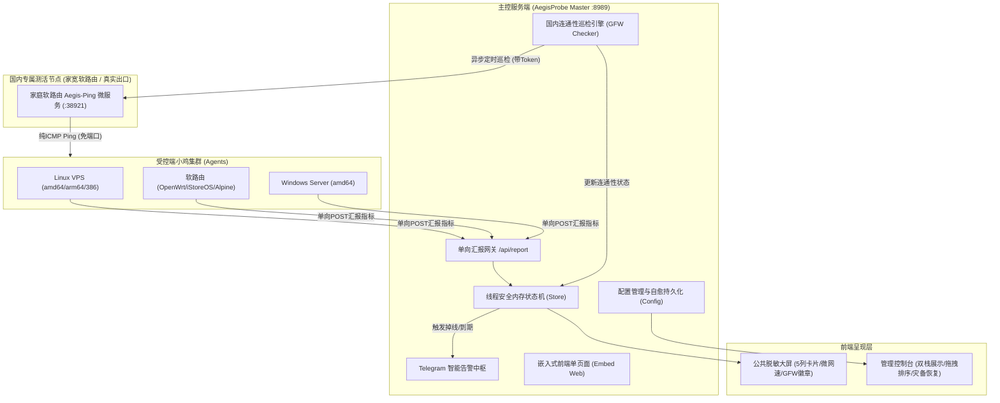

# 🛡️ 天阙·神盾安全探针 (AegisProbe) 架构设计与研发推进白皮书

> **文档版本**: `v1.2.2`
> **更新时间**: 2026-10-24  
> **维护项目**: 天阙安全实验室 (TianQue Security Lab)  
> **开源仓库**: [https://github.com/wxfyes/AegisProbe](https://github.com/wxfyes/AegisProbe)  
> **专属技能**: `~/.gemini/config/skills/tianque-probe/SKILL.md`  
> **交接目标**: 为所有参与该项目的后续开发者与 AI 助手提供 100% 透明的技术架构、已交付功能、避坑指南及下一步演进蓝图。

---

## 目录
1. [项目愿景与安全铁律](#1-项目愿景与安全铁律)
2. [技术选型与全景架构](#2-技术选型与全景架构)
3. [核心功能清单与当前跟进状态](#3-核心功能清单与当前跟进状态)
4. [核心避坑指南与深度技术细节](#4-核心避坑指南与深度技术细节)
5. [软路由自建国内测活探针方案 (Aegis-Ping，已全面落地)](#5-软路由自建国内测活探针方案-aegis-ping已全面落地)
6. [标准研发、编译与发布流水线](#6-标准研发编译与发布流水线)

---

## 1. 项目愿景与安全铁律

天阙·神盾安全探针（AegisProbe）专为**高敏感、分布式海外节点集群与商业网络中转**量身打造。彻底摒弃传统探针笨重、容易成为黑客反向跳板的顽疾，恪守四大核心安全铁律：

1. **绝对纯单向汇报，零下行渗透通道**：
   - 受控端（Agent）对主控端仅发起单向 HTTP POST 状态汇报；
   - 服务端程序绝对不内置任何下行控制指令、远程 Shell 执行、反向代理通道或动态调试接口；
   - **最高安全承诺**：即使主控服务器遭到攻击或完全沦陷，攻击者也绝对无法通过探针协议横向渗透或入侵任何一台被控小鸡！
2. **真实 IP 物理级脱敏**：
   - 监控大屏（`/`）面向公共访客开放，API `/api/nodes/summary` 在内存级严格剔除所有 IP 字段，杜绝机房 IP 暴露引来扫描攻击；
   - 真实双栈 IP 仅限登录后的管理后台（`/admin.html`）通过高强度 Session 鉴权查阅。
3. **极简轻量，零 GPU 负担**：
   - 大屏采用纯原生 JS 与 DOM 原地精准局部更新机制，彻底消灭全量重排和高功耗 WebGL 渲染；
   - 受控端 Agent 内存占用稳定在 **< 5MB**，CPU 使用率 **< 0.1%**，老旧设备、低配 VPS、软路由长期挂机零发热。
4. **单二进制纯静态内嵌交付**：
   - 前端大屏与后台资源通过 Go `embed.FS` 编译进单一独立服务端二进制，彻底杜绝静态资源丢失与路径依赖。
5. **国内连通性专属私有闭环**：
   - 彻底摒弃动辄超时、限流、误报的公共 API，由用户自建的极轻量 `aegis-ping` 微探针（部署在家宽软路由/国内轻量机）承载 100% 真实的纯 ICMP Ping 探测。

---

## 2. 技术选型与全景架构



---

## 3. 核心功能清单与当前跟进状态

| 模块 | 功能特性 | 实现细节 | 状态 |
| :--- | :--- | :--- | :--- |
| **公共大屏** | 高密度 5 列卡片布局 | 宽屏并排 5 列，紧凑卡片排布，完美兼容移动端 | ✅ 已交付 |
| **公共大屏** | 实时微仪表盘网速胶囊 | 实时显示单机上传/下载速率与累计流量 | ✅ 已交付 |
| **公共大屏** | 矢量 SVG 国旗渲染 | 内置纯矢量 SVG 算法，彻底解决 Windows 不支持国旗 Emoji 乱码 | ✅ 已交付 |
| **公共大屏** | 国内连通性徽章 | 卡片右上角根据测活结果实时展示 `✓ 畅通` 或 `✕ 被墙` | ✅ 已交付 |
| **管理后台** | 双栈 IPv4 / IPv6 展示 | 自动感知双栈，上下独立分行，每行独立带 `📋` 复制按钮 | ✅ 已交付 |
| **管理后台** | 鼠标拖拽平滑排序 | 鼠标按住 `≡` 手柄自由拖拽调整展示顺序，松开秒级持久化 | ✅ 已交付 |
| **管理后台** | 配置备份与灾难恢复 | 一键导出完整 `.json` 备份包；新机一键导入瞬间自愈，Agent 无需重配 | ✅ 已交付 |
| **管理后台** | 测活配置与周期调控 | 支持外部 API 模板、自动正则容错、预设 1~24 小时周期与【⚡立即测活】按钮 | ✅ 已交付 |
| **管理后台** | 版本号全链路展示 | 节点列表增加「探针版本」列展示小鸡 Agent 版本；顶部与侧栏展示主控版本 | ✅ 已交付 |
| **一键脚本** | 主控与被控独立运维 | 拆分独立安装/更新/卸载主控与被控端；升级国内极速双镜像 (`ghfast.top` / `ghproxy.net`) | ✅ 已交付 |
| **受控 Agent** | 4 重多源冗余双栈补齐 | 网卡全局单播扫描 + 轮询 `ip.sb`、`ident.me`、`ipify`、`icanhazip` 自动补齐 | ✅ 已交付 |
| **家宽微探针** | Aegis-Ping 自建测活服务 | 纯 Go 独立二进制 (< 2MB)，纯 ICMP Ping 免端口依赖，OpenWrt 自动防火墙放行 | ✅ **已全面实测交付** |

---

## 4. 核心避坑指南与深度技术细节

### 4.1 为什么部分小鸡先前只显示了 v6 没有显示 v4？
1. **老版本 Agent 缺乏 v4 字段**：小鸡运行的是旧版 agent，且在双栈网络中，Linux 系统会优先选择 IPv6 路由向主控发起连接，导致服务端识别到的连接 IP 只有 IPv6；
2. **VPS 网卡为内网 IP（NAT 转发）**：很多双栈小鸡的网卡是 10.x / 172.x 内网 IP，必须依赖外网接口探测；如果单一探测接口被墙或限流，会导致无法拿到公网 v4；
3. **解决方案**：升级至最新版 Agent，内置 4 重国际多源探测通道，缺少任一栈时自适应每 20 秒重试，探测成功后终生记忆。小鸡只需执行 `curl -fsSL ... | bash -s -- --update-agent` 即可秒级解决。

### 4.2 为什么测活会出现“全部被墙”？
1. **误将占位符写死为 `{80}`**：
   - 错误写法：`...&port={80}`（带大括号），第三方 API 无法解析字符串 `"{80}"` 导致直接报错失败；服务端现已增加正则容错，自动剥除大括号清洗为正常数字；
2. **小鸡根本未开放 80 端口（最关键根因）**：
   - 绝大多数中转/测试 VPS 根本没有安装 Web 服务（Nginx/Apache），小鸡操作系统的 80 端口根本没有监听；
   - TCPing 是向特定端口发起 TCP 三次握手，探测未开放的端口会遭到小鸡内核拒连（RST），从而被误判为被墙；
3. **彻底根治方案**：使用 **Aegis-Ping 纯 ICMP 模式**，直接向小鸡 IP 发起系统 Ping，**完全不需要小鸡开放任何端口**，彻底杜绝误报。

### 4.4 版本号联动维护与发版铁律
1. **单一版本源头**：全局版本号以 `internal/common/types.go` 的 `const Version = "vX.Y.Z"` 为唯一准则；
2. **严禁写死 Tag**：`cmd/publisher/main.go` 动态导入 `common.Version`，发版时自动打出对应 GitHub Release Tag，彻底杜绝代码迭代 N 个版本 Release 仍是 `v1.0.0` 的事故；
3. **前端差异化感知**：管理后台自动根据主控与小鸡版本比对，最新版渲染绿色 `${ver} ✓`，旧版渲染橙黄色 `v1.0.0 待更新`。

---

## 5. 软路由自建国内测活探针方案 (Aegis-Ping，已全面落地)

### 5.1 方案架构与价值
- **零频控限制**：完全私有，随心调用；
- **支持纯 ICMP Ping（免端口依赖）**：小鸡无论是否开放 22/80 端口，只要机器在线就能 ping 通，彻底杜绝端口关闭误报！
- **真实度 100%**：纯正中国大陆民用宽带直连海外，结果最具公信力。
- **资源极轻**：全架构单文件二进制仅 1.6~1.9 MB，运行时内存 < 2 MB，CPU 几乎为 0%。

### 5.2 核心接口一览
- `GET /health`：免鉴权健康检查；
- `GET /ping?address={ip}&token={token}`：**纯 ICMP Ping（首选推荐）**；
- `GET /tcping?address={ip}&port={port}&token={token}`：TCP 三次握手探测。

### 5.3 软路由一键安装与运维命令
```bash
# 一键安装 (自动放行 iStoreOS/OpenWrt 防火墙端口)
curl -fsSL https://ghfast.top/https://github.com/wxfyes/AegisProbe/releases/latest/download/install_aegis_ping.sh | bash -s -- --port=38921 --token=AegisSuperSecret2026

# 查看实时测活日志 (iStoreOS 终端)
logread -f -e aegis
```

---

## 6. 标准研发、编译与发布流水线

任何 AI 或开发者对代码进行修改后，必须无条件遵循以下闭环流程发布并同步：

```powershell
# 1. 前端构建产物同步至 Go embed 目录
Copy-Item -Path "web\dist\*" -Destination "internal\server\web\dist\" -Recurse -Force

# 2. 本地全架构交叉编译 (10秒内完成输出至 bin/，覆盖 Server, Agent, Aegis-Ping)
powershell -File scripts/build_all.ps1

# 3. 极速发布至 GitHub Release (清理旧资产并秒级直传)
go run ./cmd/publisher/...

# 4. 代码提交并推送到 GitHub 仓库
git add -A
git commit -m "feat/fix: 更新说明"
$token = (Get-Content .token).Trim()
git push "https://${token}@github.com/wxfyes/AegisProbe.git" main
```
